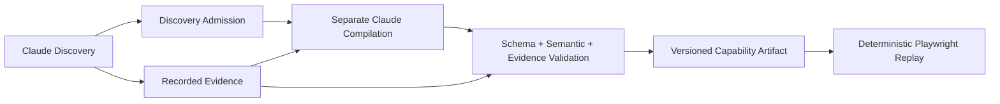
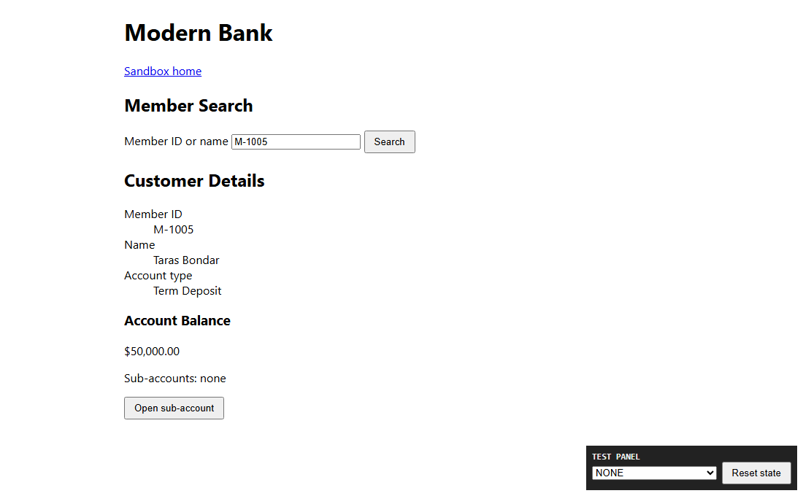
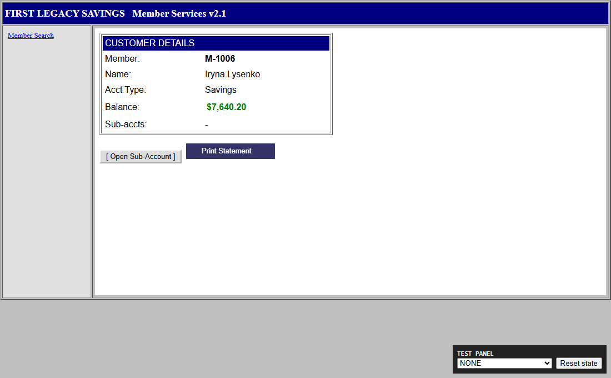
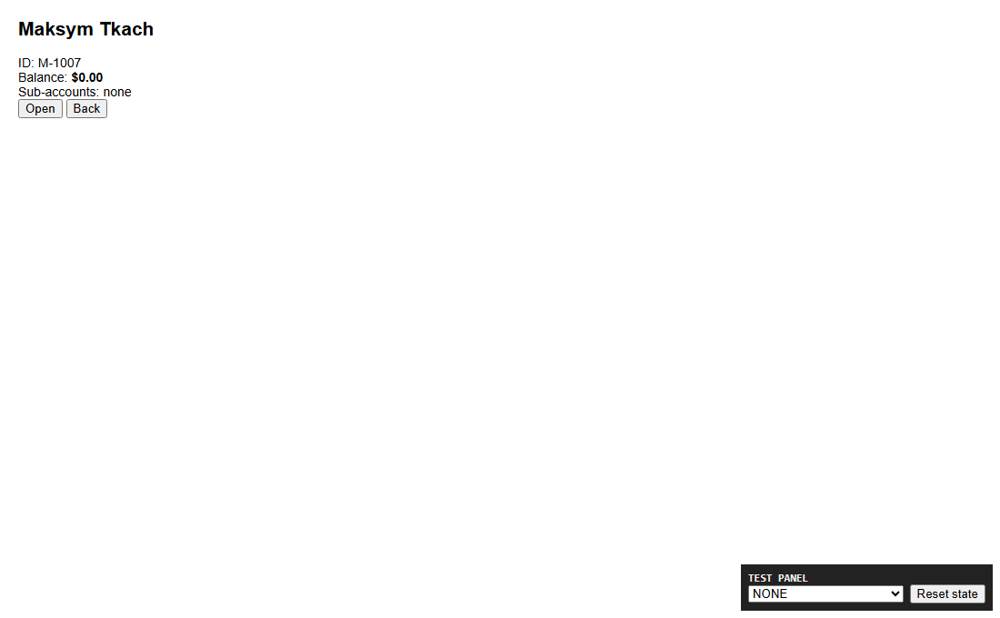

# Agentic Workflow Engine

Discover a UI workflow with Claude, compile a typed capability, validate it, then
replay it deterministically with Playwright and no LLM in the execution loop.
This is a focused TypeScript/Node.js web MVP using synthetic banking data.

**Status:** Completed and validated within the documented synthetic/public web
MVP scope. Sections §3.1–§3.6 have implementation and test evidence; §3.7 provides
the required extension design. Remaining [pre-submission concerns](docs/reviewer-readiness.md)
are tracked separately from MVP scope and production limitations.

**Review first:** [design report](REPORT.md), [latest genuine Claude E2E](evidence/safety-3-4/final-live-e2e/README.md),
and [live human handoff acceptance](evidence/discovery-handoff/manual/README.md).

## Quick Start — no API key required

Requires Node.js **24.x** (verified with 24.14.0), npm and Playwright Chromium.
Dependencies are locked in `package-lock.json`. Run from the repository root.
The commands use `npm`/`npx`; in Windows PowerShell use `npm.cmd`/`npx.cmd` if
script execution policy blocks the `.ps1` wrappers. Linux browser dependencies
may require `npx playwright install --with-deps chromium` and system privileges;
this review was executed on Windows, not Linux.

```sh
git clone https://github.com/JohnnyMahoney/Agentic-Workflow-Engine.git
cd Agentic-Workflow-Engine
npm ci
npx playwright install chromium
npm run build
npm run sandbox:serve
```

Leave that terminal running. Open http://localhost:8080/modern.html if desired.
If port 8080 is occupied, stop the conflicting server; the supplied request,
artifact and trusted policy expect this origin. Automation uses a fresh browser
context with separate localStorage; it does not reset your existing browser.

In a second terminal, from the same repository root:

```sh
node dist/capability/cli.js replay --artifact evidence/safety-3-4/final-live-e2e/compilation/artifact.json --input memberId=M-1005 --policy examples/banking/policy.json --out evidence/local-review/replay-1 --headless
```

Expected: **SUCCESS**, **M-1005 / Term Deposit / $50,000.00**, and
`outputReadiness: validated`. This reuses a genuine Claude-generated artifact;
it makes **zero model calls** and does not require `.env`. Internet access is
needed for initial dependency/browser downloads, not for this localhost Replay.
Remove `--headless` to watch Chromium. Output paths must be fresh: change `replay-1`
for another run. Results and events are written beneath `--out`.

Run verification while the sandbox remains running:

```sh
npm run typecheck
node --test --test-concurrency=1 dist/tests/*.test.js
npm run test:banking
```

The main suite uses synthetic fixtures, saved evidence and scripted API responses;
real-browser handoff tests simulate operators. Banking tests use hand-authored
runtime artifacts against the bundled UI, not new Claude runs. Both need no key.
`npm test` is also available, but its parallel workers can hit the bounded pattern
validation timeout; the sequential command above is the recommended review path.
[Actual verification results and concerns](docs/reviewer-readiness.md).

## Architecture and assessment coverage



Admission establishes eligibility, not business success. Compilation proposes JSON;
the deterministic Builder gates artifact saving. Replay verifies checkpoints and
output readiness. See [decisions](DECISIONS.md) and the seven-section [REPORT](REPORT.md).

| Requirement | Implementation / navigation | Verified evidence / design |
| --- | --- | --- |
| §3.1 Discovery | [Orchestration](src/discovery/run.ts), [Claude browser driver](src/discovery/local-browser.ts) | [Genuine Discovery](evidence/safety-3-4/final-live-e2e/discovery/summary.json) |
| §3.2 Capability | [v2.1 schema](src/capability/contract.ts), [separate compiler](src/capability/compile.ts), [Builder/validator](src/capability/builder.ts) | [Artifact](evidence/safety-3-4/final-live-e2e/compilation/artifact.json), [validation](evidence/safety-3-4/final-live-e2e/compilation/validation.json), [contract guide](docs/capability-v2.md) |
| §3.3 Replay | [Engine](src/replay/engine.ts), [SurfaceAdapter](src/surfaces/adapter.ts), [Playwright implementation/resolver](src/surfaces/playwright.ts) | [Genuine Replay](evidence/safety-3-4/final-live-e2e/replay/result.json), [runtime fixtures](evidence/safety-3-4/banking/README.md), [error handling](REPORT.md#determinism--error-handling) |
| §3.4 Safety | [Trusted policy](src/safety/policy.ts), [persistence sanitizer](src/safety/persistence.ts) | [Safety tests and limits](docs/safety.md), [verification](evidence/safety-3-4/README.md) |
| §3.5 Evidence | [Recorder](src/discovery/recorder.ts), [DOM evidence](src/capability/evidence.ts) | [Curated index](evidence/README.md); new raw screenshots are omitted, sanitized diagnostics retained |
| §3.6 Handoff | [Shared CLI control transfer](src/replay/handoff.ts), [Discovery integration](src/discovery/handoff.ts), recovery inside Replay engine | [Real operator acceptance](evidence/discovery-handoff/manual/README.md), [operator guide](docs/handoff.md) |
| §3.7 Heterogeneity | Web implementation; desktop adapters, tenant overrides and drift management are proposed designs | [Design and trade-offs](REPORT.md#heterogeneity--multi-tenant) |

Tests are in [src/tests](src/tests/). The approach has been exercised on three web
fixtures; this is not arbitrary-site or production banking certification.

## Banking Sandbox and verified scenarios

I built a [synthetic Banking Sandbox](banking-sandbox/README.md) with Modern forms,
Legacy tables/iframes and an Awkward UI with ambiguous controls and delayed values.
Historical evidence includes lookups on all three and verified Youth sub-account
creation on Modern and Awkward. Legacy creation exposed a real fixture defect.
The [six-case index](evidence/e2e-round-2/README.md) preserves failures and retries;
current narrow safety permissions must be reviewed separately for each surface.

| Modern | Legacy | Awkward |
| --- | --- | --- |
|  |  |  |

*These are existing synthetic UI previews captured for the README, not new test
runs. Current runtime safety policy does not persist raw screenshots.*

## Genuine Discovery → Compilation → Replay — paid API stages

Only **Discovery and Compilation** require `ANTHROPIC_API_KEY` and make paid API
calls. For these stages, copy `.env.example` to the ignored `.env` and set the key:
PowerShell `Copy-Item .env.example .env`, or Bash `cp .env.example .env`. Do this
only if `.env` does not exist. Optional `CLAUDE_MODEL` overrides the tested default;
access to that model depends on your Anthropic account. Browserbase is not required.

With the sandbox running, run each stage only after the previous stage succeeds:

```sh
npm run capability:discover -- --request examples/banking/member-balance.json --policy examples/banking/policy.json --out evidence/local-review/new-discovery --headless
npm run capability:compile -- --evidence evidence/local-review/new-discovery/discovery-v2.json --policy examples/banking/policy.json --out evidence/local-review/new-compilation
npm run capability:replay -- --artifact evidence/local-review/new-compilation/artifact.json --input memberId=M-1005 --policy examples/banking/policy.json --out evidence/local-review/new-replay --headless
```

Use fresh directories for repetitions. Compilation includes validation; rejected
candidates do not produce accepted artifacts. [Compilation retry with saved evidence](docs/capability-v2.md)
does not require rediscovery. Validation and Replay require no paid model access.

## Human Handoff — Live Demonstration

Handoff preserves the same live browser/context **within a run**. Discovery and
fresh Replay remain separate sessions. Existing [genuine live evidence](evidence/discovery-handoff/manual/README.md)
covers successful continuation, unresolved Resume, Abort, and rejected manual
business actions. Automated simulated-operator tests are labeled separately.

For a no-key demonstration, start the small operator-blocker demo in another terminal:

```sh
node scripts/serve-discovery-handoff-demo.mjs
```

Then use an interactive terminal to replay the saved genuine handoff artifact:

```sh
npm run capability:replay -- --artifact evidence/discovery-handoff/manual/test2-guard-20261109-185606/compilation/artifact.json --input memberId=M-1001 --policy examples/discovery-handoff/policy.json --out evidence/local-review/handoff-1 --handoff
```

The demo uses port **8081**; the Banking Sandbox uses **8080**. At the pause, enter
`take-control`, click **Acknowledge access as operator** in the automation browser,
then enter `resume`. Expected: `SAFE_RETRY` followed by `SUCCESS` with M-1001,
Checking and $2,450.75. `abort` stops the run. `--handoff` requires a visible browser
and an interactive terminal; it cannot be combined with `--headless`.

| Screenshot placeholder | Caption |
| --- | --- |
| 1 — Not captured yet | Automation paused with intervention reason and current step. |
| 2 — Not captured yet | After take-control, the human operates the same browser session. |
| 3 — Not captured yet | After Resume, verification allows continuation and returns SUCCESS. |

The author will add real screenshots under [docs/media/handoff](docs/media/handoff/README.md).
No missing image files are embedded. [Replay recovery rules](docs/handoff.md) and
[Discovery admission limits](docs/discovery-handoff.md) explain the implementation.

## Scope and known limitations

- Trusted synthetic/public data classification is required; sensitive applications
  are refused. Arbitrary PII needs trusted classification; this is not universal DLP.
- Actual-target policy rules are narrow. Historical artifacts remain readable, but
  historical policy copies may need migration. The current Modern policy does not
  automatically authorize Legacy, Awkward or other application versions.
- New screenshots are omitted; sanitized DOM diagnostics are saved. Historical
  synthetic evidence and manually captured documentation previews are preserved.
- Handoff is bounded and local. Arbitrary login/MFA, manual business operations,
  multi-tab control, OS locking and crash resume are unsupported.
- Linear workflows do not support the existing-account conditional branch.
  v2.0 artifacts can report legacy-unverified readiness; v2.1 adds declared checks.
- Desktop, tenant override infrastructure and compatibility probes are designs,
  not implemented features. The Legacy control defect is preserved.

Original assignment materials stay locally in ignored `assignment/` by the author's
choice; they are not needed to run a fresh clone. The public [REPORT](REPORT.md)
and requirement mapping above explain coverage. [Final verification and remaining
submission concerns](docs/reviewer-readiness.md) include the dependency audit.
