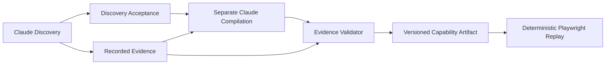

# Agentic Workflow Engine

Discover once. Compile a typed capability. Replay deterministically without an LLM.

A TypeScript/Node.js MVP for turning UI-only business tasks into reviewable,
parameterized automation. Claude explores a real application; deterministic
validation gates the saved workflow that Playwright executes.

## Banking Sandbox and verified scenarios

I built a [synthetic Banking Sandbox](banking-sandbox/README.md) with three UIs
for the same member-service tasks: Modern forms, Legacy tables/iframes, and an
intentionally Awkward interface with ambiguous controls and delayed values.

Saved end-to-end evidence demonstrates successful member lookups on all three
surfaces and verified Youth sub-account creation on Modern and Awkward. Legacy
creation exposed a real fixture defect; it is not counted as a successful creation.
See the [test results](evidence/e2e-round-2/README.md) for exact outcomes and retries.

| Modern | Legacy | Awkward |
| --- | --- | --- |
|  |  |  |

*Screenshots show the running bundled UI with synthetic data, captured for this
README. They are UI previews, not new Claude test runs. Click an image to enlarge.*

## Architecture



Discovery admission establishes eligibility, not business success. Compilation
proposes JSON; Zod, semantic checks and recorded-state validation decide whether
to save it. Replay has no model in its decision loop. See [decisions](DECISIONS.md)
and the [design report](REPORT.md).

## Current status — work in progress

| Assignment area | Current scope |
| --- | --- |
| §3.1 Discovery | Implemented/tested with genuine Claude runs on Modern, Legacy and Awkward web UIs. |
| §3.2 Capability | Implemented/tested: versioned schema, explicit inputs, targets, outputs and checkpoints. |
| §3.3 Replay | Implemented/tested for this web MVP: parameterization, output readiness, typed outcomes and bounded recovery. Evidence includes failed runs and subsequent fixes; not universal reliability or final assignment acceptance. |
| §3.4 Safety | Partial: origin/action policy and conservative write handling; production redaction and comprehensive risky-action controls remain. |
| §3.5 Evidence | Structured logs, snapshots, validation reports and failure screenshots available for synthetic fixtures. |
| §3.6 Handoff | Accepted for the current web MVP: genuine Claude Discovery, separate Compilation and fresh Replay with a real operator; success, unresolved, abort and rejected manual actions verified. [Live acceptance](evidence/discovery-handoff/manual/README.md). |
| §3.7 Heterogeneity | Web adapter seam and three web surfaces demonstrated; desktop and tenant reuse remain design work. |

## Prerequisites and setup

Node.js 22.18+ (verification environment: 24.14.0), npm and Chromium are required.
Dependencies are pinned by package-lock.json: Anthropic SDK, Playwright, Zod and
TypeScript. Commands below use Windows PowerShell; on other shells use npm/npx
instead of npm.cmd/npx.cmd and adapt variable assignment.

```powershell
npm.cmd ci
npx.cmd playwright install chromium
# Once, only if .env does not already exist:
Copy-Item .env.example .env
```

Set ANTHROPIC_API_KEY in the root .env for Discovery and Compilation. Never commit
it. Browserbase is not needed for the local driver. Optional CLAUDE_MODEL overrides
the code's tested default; model access depends on your Anthropic account.
Serving the sandbox, validation, tests and Replay require no API key or model calls.

## Launch the Banking Sandbox

```powershell
npm.cmd run sandbox:serve
```

Open http://localhost:8080/: [Modern](http://localhost:8080/modern.html),
[Legacy](http://localhost:8080/legacy/index.html), or
[Awkward](http://localhost:8080/awkward.html). Stop any existing server on 8080 first.
This Node server serves only the bundled fixture; it does not reset browser data.
Fresh automation contexts have separate localStorage from your existing browser.
See [sandbox setup and known defects](banking-sandbox/INTEGRATION.md).

Optional Python alternative, from the actual fixture directory (do not run both):

```powershell
cd banking-sandbox
python -m http.server 8080 --bind 127.0.0.1
```

Return to the repository root for the commands below.

## Run the full pipeline

With the sandbox running, this request finds M-1005 and returns member ID,
account type and balance. It supplies a goal and bindings, not steps or selectors.
Discovery and Compilation make paid API calls. Compilation includes validation.

```powershell
$run = Join-Path 'evidence/banking-demo' (Get-Date -Format 'yyyy-MM-ddTHH-mm-ss')
npm.cmd run capability:discover -- --request examples/banking/member-balance.json --policy examples/banking/policy.json --out "$run/discovery"
npm.cmd run capability:compile -- --evidence "$run/discovery/discovery-v2.json" --policy examples/banking/policy.json --out "$run/compilation"
npm.cmd run capability:replay -- --artifact "$run/compilation/artifact.json" --input memberId=M-1005 --policy examples/banking/policy.json --out "$run/replay"
```

Discovery and Replay CLI commands open a visible browser by default, so you can
watch the automation. Add `--headless` to either command to hide the browser.
The browser uses a fresh isolated session and closes when the run finishes;
add `--handoff` for same-session CLI takeover/resume in Discovery or Replay.
Automated test suites remain headless. See [Replay instructions](docs/handoff.md)
and the [Discovery-to-Replay operator demo](examples/discovery-handoff/README.md).

Run each stage only if the previous one succeeds. Output directories must be empty.
A rejected candidate does not produce an artifact. Preserve its evidence and
[retry compilation with feedback](docs/capability-v2.md), without repeating Discovery.

For a demo **without model access**, replay the saved genuine Modern artifact:

```powershell
$run = Join-Path 'evidence/reviewer-replay' (Get-Date -Format 'yyyy-MM-ddTHH-mm-ss')
npm.cmd run capability:replay -- --artifact evidence/e2e-round-2/test-1-modern-M1005/compilation/artifact.json --input memberId=M-1005 --policy examples/banking/policy.json --out "$run"
```

Replay writes result.json and events.jsonl, plus failure diagnostics when available.
Non-SUCCESS outcomes return a nonzero CLI exit code; inspect status and code.
OUTCOME_UNKNOWN means reconcile actual state before attempting a new write.

## Tests

```powershell
npm.cmd run build
npm.cmd run typecheck
npm.cmd test
# Keep the sandbox running in another terminal:
npm.cmd run test:banking
```

The first suite uses synthetic pages/mocks and saved evidence. The banking suite
runs hand-authored runtime fixtures against real browser UI in isolated contexts;
it is not Claude Discovery. It writes evidence/runtime-3-3/<timestamp>/.
Set BANKING_SANDBOX_URL and RUNTIME_EVIDENCE_DIR to override its URL and output.
[Cleanup verification](docs/reviewer-readiness.md) records actual results.

## Evidence

Start with the [reviewer evidence index](evidence/README.md): genuine lookup,
verified account creation, a real negative replay, and regression evidence.
The [six-case index](evidence/e2e-round-2/README.md) distinguishes successful
pipelines, recompilations and the administrator-confirmed Legacy UI defect.
Historical failures remain unchanged and are not counted as successful runs.

## Limitations and next steps

- Synthetic/public test data only; DOM, screenshots and outputs are not fully PII-redacted.
- Handoff is opt-in and requires an interactive terminal. Discovery compilation
  admits only proven, trusted-policy blocker dismissals; arbitrary human business
  actions fail closed. Live full-pipeline acceptance covers the controlled demo;
  arbitrary authentication and human business operations remain unsupported.
  Without --handoff, failure closes the session.
- Linear workflows cannot safely express the existing-account conditional branch.
- v2.0 artifacts remain compatible but may report legacy-unverified output readiness;
  v2.1 adds declared readiness checks. Sparse evidence cannot prove all future states.
- CSS/role/frame strategies are web-specific. No desktop adapter or tenant override system exists.
- The Legacy fixture has a known broken account-type control; Awkward omits primary account type.

Technical detail: [contract/CLI](docs/capability-v2.md), [runtime outcomes](docs/runtime-3-3.md),
[output readiness](docs/output-readiness.md), [Discovery acceptance](docs/discovery-acceptance.md).
